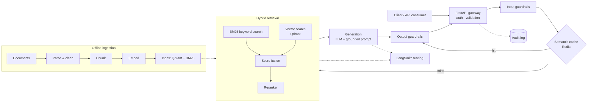

# Secure Hybrid RAG Platform — Reference Architecture

A production-style Retrieval-Augmented Generation (RAG) architecture designed for **regulated domains** such as healthcare and insurance, where answers must be accurate, traceable and safe to audit.

> **About this repository:** the implementation is private. This repository documents the architecture, key design decisions (ADRs), security model and evaluation approach. Implementation walkthroughs are available on request.

---

## The problem

Most RAG prototypes work in a demo and break in production for four predictable reasons:

| Failure mode | What it looks like | How this architecture addresses it |
|---|---|---|
| **Weak retrieval** | Vector search misses exact terms such as policy numbers, procedure codes or product names | Hybrid retrieval (BM25 + vector) followed by reranking |
| **Uncontrolled output** | Answers drift outside the source documents or expose sensitive data | Input and output guardrails around generation |
| **No accountability** | Nobody can explain why the system gave an answer | Audit logging and end-to-end tracing for every request |
| **No quality signal** | Changes to prompts, chunking or models silently degrade answers | Automated RAG evaluation as a release gate |

Cost and latency are the fifth concern, addressed with semantic caching.

## Architecture at a glance

More detail: [docs/architecture.md](docs/architecture.md)

## Key capabilities

- **Hybrid retrieval:** keyword (BM25) and semantic (vector) search run in parallel, results are fused, then reranked for precision.
- **Semantic caching:** semantically similar questions reuse previous answers, reducing LLM calls, latency and cost.
- **Guardrails:** checks before the model (prompt injection, out-of-scope or sensitive requests) and after it (grounding, sensitive-data leakage).
- **Audit logging:** each request records who asked, what was retrieved, which model answered and which guardrails fired.
- **Observability:** LangSmith tracing across retrieval and generation steps.
- **Evaluation:** an automated RAG evaluation suite measures retrieval and answer quality and blocks regressions.

## Layered design

| Layer | Responsibility |
|---|---|
| `api` | HTTP interface, authentication, request validation |
| `core` | Configuration, shared models, dependency wiring |
| `ingestion` | Parsing, cleaning, chunking, embedding, indexing |
| `retrieval` | BM25, vector search, fusion, reranking |
| `generation` | Prompt assembly, LLM calls, citation of sources |
| `guardrails` | Input and output policy checks |
| `cache` | Semantic cache lookups and writes |
| `observability` | Tracing, structured logs, audit records |
| `evals` | Evaluation datasets, metrics, regression gates |

Each layer depends only on interfaces, so retrievers, vector stores, rerankers and LLM providers can be swapped without touching the API. See [ADR-0004](docs/adr/0004-layered-pluggable-architecture.md).

## Architecture Decision Records

| ADR | Decision |
|---|---|
| [0001](adr/0001-hybrid-retrieval.md) | Use hybrid retrieval (BM25 + vector) instead of vector-only search |
| [0002](docs/adr/0002-semantic-caching.md) | Add a semantic cache in front of retrieval and generation |
| [0003](docs/adr/0003-guardrails-and-audit-logging.md) | Treat guardrails and audit logging as core layers, not middleware add-ons |
| [0004](docs/adr/0004-layered-pluggable-architecture.md) | Layered architecture with provider-agnostic interfaces |
| [0005](docs/adr/0005-evaluation-as-release-gate.md) | Automated RAG evaluation as a release gate |

## Further documentation

- [Security & compliance model](docs/security.md)
- [Evaluation approach](docs/evaluation.md)

## Technology

Python · FastAPI · LangChain · Qdrant · Redis · BM25 · LangSmith

## Author

**Suryamitra Yellayi** — AI Solution Architect · [LinkedIn](https://www.linkedin.com/in/suryamitra-yellayi/)
