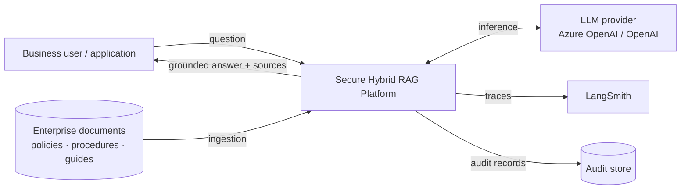
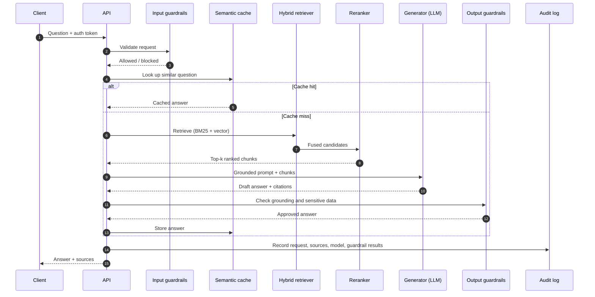
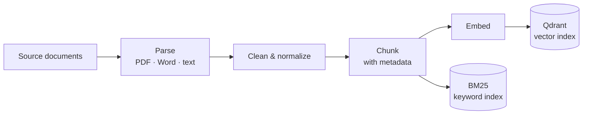
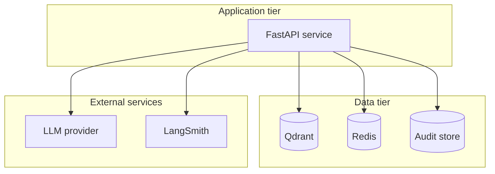

# Architecture

## 1. Context

The platform sits between users and enterprise knowledge. It never lets the model answer from memory alone: every answer is grounded in retrieved documents and returned with its sources.

## 2. Request flow (online path)

## 3. Ingestion flow (offline path)

Each chunk keeps metadata (source document, section, version) so that answers can cite sources and so that access or retention rules can be applied at retrieval time.

## 4. Why each component exists

| Component | Without it | With it |
|---|---|---|
| BM25 | Exact identifiers and rare terms are missed | Precise matches on codes, IDs and terminology |
| Vector search | Paraphrased questions are missed | Matches on meaning, not just words |
| Fusion + reranker | Two ranked lists with incompatible scores | One precise list of the most relevant chunks |
| Semantic cache | Every repeated question pays full LLM cost and latency | Repeated questions answered from cache |
| Input guardrails | Prompt injection and out-of-scope requests reach the model | Unsafe requests stopped before inference |
| Output guardrails | Ungrounded or sensitive content can reach users | Answers checked before release |
| Audit log | No way to explain or defend an answer later | Full record per request |
| Tracing | Failures are hard to diagnose | Step-by-step visibility of retrieval and generation |
| Evaluation | Quality regressions go unnoticed | Changes judged by metrics before release |

## 5. Deployment view

The API is stateless, so it scales horizontally. State lives in Qdrant (vectors), Redis (cache) and the audit store.

## 6. Extension points

The same foundation supports further use cases without changing the core layers:

- Codebase question answering
- Root-cause analysis over incident and log data
- Text-to-SQL over governed data sources
- MCP-based tool access for assistants
- Multi-agent workflows built on the retrieval layer
